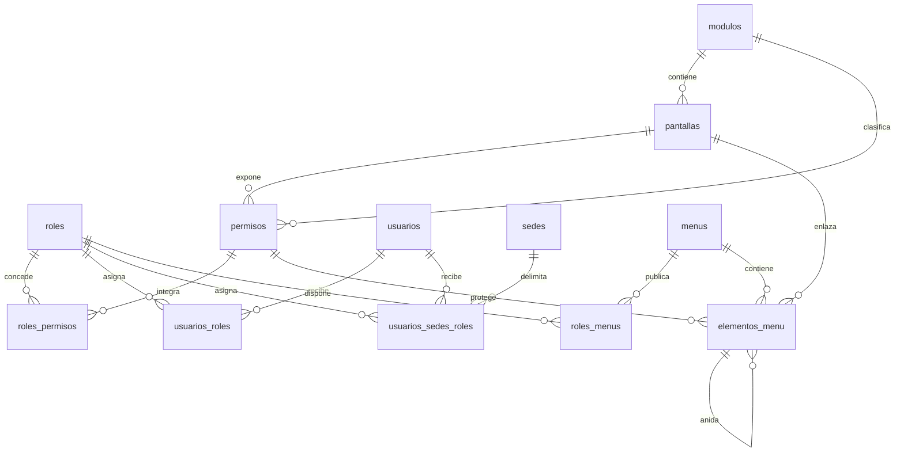

# Relaciones del RBAC

El ámbito (`empresa`, `sede` o `propio`) vive en la relación `roles_permisos` y en la asignación por sede; no se replica en columnas por módulo ni por rol. La matriz administra únicamente relaciones existentes y el servidor vuelve a validar autorización, alcance, concurrencia y conservación del último acceso administrativo global.
